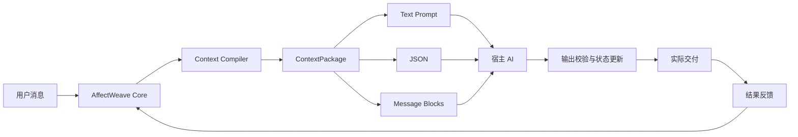

# AffectWeave


**Give AI characters emotional continuity.**

AffectWeave 是一个持续人物状态与上下文增强引擎。它长期维护人物的人格、情绪、关系、记忆和未完成事件，并在每轮对话前，将当前相关状态编译为紧凑的 `ContextPackage`。

同一份 `ContextPackage` 可以渲染为文本提示词、结构化 JSON 或通用消息块，再交给宿主已有的 AI。宿主返回结构化结果后，AffectWeave 校验状态变化，并根据实际交付和后续结果持续更新人物轨迹。



## AffectWeave 能做什么

- **持续人物状态**：维护 Persona、中期状态、情绪实例、关系、ActiveThread 和情节记忆。
- **上下文编译**：从完整状态中选择当前相关内容，生成有预算限制的 `ContextPackage`。
- **多格式渲染**：将同一份上下文渲染为文本提示词、JSON 或通用消息块。
- **裁剪审计**：记录上下文预算、包含内容、删除内容和删除原因。
- **结构化状态提案**：校验宿主 AI 返回的 JSON，并限幅情绪、关系和中期状态变化。
- **真实行为闭环**：区分候选回复、实际交付、观察结果和确认结果。
- **状态持久化**：支持内存仓库和 SQLite。

## 5 分钟本地验证

```bash
python -m pip install -e .
python -m unittest discover -s tests -v
python examples/basic_host.py
python examples/rendering_formats.py
```

## 最小 Python 接入

```python
from datetime import datetime, timezone

from affectweave import AffectWeave
from affectweave.core import (
    InputEvent,
    make_maya_bennett_medium,
    make_maya_bennett_persona,
)

now = datetime.now(timezone.utc)
affectweave = AffectWeave()

state = affectweave.create_character(
    "maya",
    persona=make_maya_bennett_persona(),
    medium=make_maya_bennett_medium(now),
    now=now,
)

packet = affectweave.prepare_turn(
    "maya",
    InputEvent(
        actor_id="mighon",
        message="Hello, Maya.",
        occurred_at=now,
    ),
    idempotency_key="turn-1:prepare",
    expected_state_version=state.version,
)

# 选择适合宿主的上下文形式。
prompt = packet.to_prompt()
context_json = packet.to_context_json()
message_blocks = packet.to_messages()

raw_output = host_ai_generate_json(
    prompt=prompt,
    output_schema=packet.output_schema,
)

committed = affectweave.commit_output(
    "maya",
    packet,
    raw_output,
    idempotency_key="turn-1:commit",
)

reply = committed.behavior.generated_text
host_display(reply)

delivered = affectweave.record_delivery(
    "maya",
    packet.behavior_id,
    reply,
    idempotency_key="turn-1:delivery",
)
```

## Context Pipeline

### 1. Core 生成 TurnPreparation

Core 读取完整人物状态、当前关系、ActiveThread、相关记忆和当前事件，生成本轮准备数据。

### 2. ContextCompiler 生成 ContextPackage

```python
from affectweave.compiler import ContextCompiler, ContextConfig

compiler = ContextCompiler(
    ContextConfig(
        token_budget=1200,
        max_memories=5,
        max_recent_turns=8,
    )
)

context = compiler.compile(turn_preparation)
```

`ContextPackage` 包含：

```text
current_event
character
current_state
relationship
active_threads
relevant_memories
recent_dialogue
response_policy
output_contract
budget
trace
```

查看预算和裁剪结果：

```python
context.budget.estimated_tokens
context.budget.maximum_tokens
context.budget.removed_sections
context.budget.removal_reasons
```

### 3. Renderer 转换输出形式

```python
from affectweave.compiler import (
    JSONRenderer,
    MessageBlockRenderer,
    TextPromptRenderer,
)

text = TextPromptRenderer().render(context)
structured = JSONRenderer().render(context)
messages = MessageBlockRenderer().render(context)
```

通过 `EnhancementPacket` 可以直接使用便利方法：

```python
packet.prompt_fragment       # 兼容属性，等同默认文本渲染
packet.to_prompt()           # 文本提示词
packet.to_context_json()     # ContextPackage JSON
packet.to_messages()         # 通用消息块
packet.output_schema         # 宿主 AI 的结构化输出 Schema
```

### 4. commit_output()

宿主 AI 返回 JSON 后：

```python
committed = affectweave.commit_output(
    "maya",
    packet,
    raw_model_json,
    idempotency_key="turn-1:commit",
)
```

AffectWeave 校验结构、拒绝受保护字段、执行状态限幅，并保存候选回复。

### 5. record_delivery()

回复真正显示或发送后：

```python
delivered = affectweave.record_delivery(
    "maya",
    packet.behavior_id,
    committed.behavior.generated_text,
    idempotency_key="turn-1:delivery",
)
```

### 6. record_outcome()

观察到后续用户反应或明确结果后：

```python
from affectweave.core import EvidenceLevel, OutcomeEvent, RelationshipDelta

affectweave.record_outcome(
    "maya",
    packet.behavior_id,
    OutcomeEvent(
        outcome_id="turn-1:user-response",
        evidence_level=EvidenceLevel.L2,
        occurred_at=now,
        summary="用户继续正常交流。",
        relationship_delta=RelationshipDelta(warmth=0.01),
    ),
    idempotency_key="turn-1:outcome",
    expected_state_version=delivered.state_version,
)
```

## 三种上下文形式

### 文本提示词

```python
prompt = packet.to_prompt(include_schema=True)
```

适合直接追加到宿主的系统提示词或开发者提示词。

### 结构化 JSON

```python
context_json = packet.to_context_json()
```

适合自定义 Agent、工具链、跨语言宿主和调试界面。

### 通用消息块

```python
messages = packet.to_messages()
```

默认输出：

```json
[
  {
    "role": "developer",
    "content": "..."
  }
]
```

宿主可以将它映射到自己支持的指令角色。

## CLI

初始化人物：

```bash
affectweave --db runtime/affectweave.sqlite3 init --character maya
```

输出完整 Packet：

```bash
affectweave --db runtime/affectweave.sqlite3 prepare \
  --character maya \
  --actor mighon \
  --message "Hello, Maya" \
  --idempotency-key session-1-turn-1 \
  --format packet
```

输出文本提示词：

```bash
affectweave ... prepare ... --format prompt
```

输出 ContextPackage JSON 与预算报告：

```bash
affectweave ... prepare ... --format context --show-budget
```

输出通用消息块：

```bash
affectweave ... prepare ... --format messages
```

## 核心状态

| 状态 | 作用 |
|---|---|
| Persona | 身份、价值观、人格参数和稳定底色 |
| Medium State | 愉悦度、激活度、精力和压力 |
| Emotion Episode | 情绪类型、原因、对象、强度和未解决程度 |
| Relationship | 熟悉度、信任、温度、可靠度、冲突和姿态 |
| ActiveThread | 仍在推进的目标、担忧、承诺和等待结果 |
| Episodic Memory | 带来源和证据等级的互动记忆 |
| Behavior | 候选回复、实际交付和后续结果 |

行为证据：

| 等级 | 含义 |
|---|---|
| L0 | AI 已生成候选回复 |
| L1 | 回复已实际发送或显示 |
| L2 | 已观察到后续用户反应或互动结果 |
| L3 | 结果得到明确确认或独立验证 |

## 模块说明

### `affectweave.core`

负责人物状态、更新规则、行为闭环和持久化。

### `affectweave.compiler.context`

负责选择、压缩和预算管理，输出 `ContextPackage`。

### `affectweave.compiler.renderers`

负责将 `ContextPackage` 渲染为文本、JSON 或消息块。

### `affectweave.compiler.packet`

定义 `ContextPackage`、`EnhancementPacket`、预算报告、追踪信息和输出 Schema。

### `affectweave.compiler.validator`

负责校验宿主 AI 的结构化输出。

### `affectweave.integration`

提供：

```text
prepare_turn
commit_output
record_delivery
record_outcome
```

### `affectweave.cli`

向 Shell、编码代理和其他进程提供同一套工作流。

## 项目结构

```text
affectweave/
├── src/affectweave/
│   ├── core/
│   ├── compiler/
│   │   ├── context.py
│   │   ├── packet.py
│   │   ├── renderers.py
│   │   ├── prompt.py
│   │   └── validator.py
│   ├── integration.py
│   ├── cli.py
│   └── __init__.py
├── tests/
├── examples/
├── docs/
├── .github/
├── README.md
├── LICENSE
└── pyproject.toml
```

## 开发

```bash
python -m pip install -e .
python -m unittest discover -s tests -v
python examples/basic_host.py
python examples/rendering_formats.py
```

贡献流程见 [`CONTRIBUTING.md`](CONTRIBUTING.md)。
