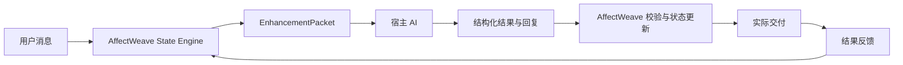

# AffectWeave


**Give AI characters emotional continuity.**

AffectWeave 是一个持续人物状态与提示词增强引擎，用于让现有 AI 保有人格、情绪、关系、记忆和未完成事件的连续性。

它将人物完整状态保存在模型上下文之外，并在每轮对话前编译一份紧凑的 `EnhancementPacket`。宿主 AI 使用 Packet 生成回复，再将实际交付和后续结果回传，持续编织人物的情感、关系与行为轨迹。



## AffectWeave 能做什么

- **持续人物状态**：保存 Persona、中期状态、情绪实例、关系、ActiveThread 和情节记忆。
- **紧凑上下文编译**：从完整状态中筛选当前相关信息，生成有预算限制的提示词片段。
- **结构化状态提案**：接收宿主 AI 返回的 JSON，校验并限幅情绪、关系和中期状态变化。
- **真实行为闭环**：区分候选回复、实际交付、观察结果和确认结果。
- **跨宿主复用**：通过统一的 Packet 与 JSON Schema 接入 Python 应用、编码代理、游戏角色或其他 AI 宿主。
- **本地持久化**：支持内存仓库和 SQLite 状态存储。

## 5 分钟快速开始

### 1. 安装

```bash
python -m pip install -e .
```

### 2. 运行测试

```bash
python -m unittest discover -s tests -v
```

### 3. 运行完整示例

```bash
python examples/basic_host.py
```

示例执行以下流程：

```text
prepare_turn
→ 宿主 AI 生成 JSON
→ commit_output
→ 宿主实际发送回复
→ record_delivery
→ record_outcome
```

## 最小 Python 接入

```python
from datetime import datetime, timezone

from affectweave import AffectWeave
from affectweave.core import (
    InputEvent,
    make_maya_bennett_medium,
    make_maya_bennett_persona,
)

now = datetime.now(timezone.utc)
affectweave = AffectWeave()

state = affectweave.create_character(
    "maya",
    persona=make_maya_bennett_persona(),
    medium=make_maya_bennett_medium(now),
    now=now,
)

packet = affectweave.prepare_turn(
    "maya",
    InputEvent(
        actor_id="mighon",
        message="Hello, Maya.",
        occurred_at=now,
    ),
    idempotency_key="turn-1:prepare",
    expected_state_version=state.version,
)

# 使用宿主已有的模型调用。
raw_output = host_ai_generate_json(
    prompt=packet.prompt_fragment,
    output_schema=packet.output_schema,
)

committed = affectweave.commit_output(
    "maya",
    packet,
    raw_output,
    idempotency_key="turn-1:commit",
)

reply = committed.behavior.generated_text
host_display(reply)

affectweave.record_delivery(
    "maya",
    packet.behavior_id,
    reply,
    idempotency_key="turn-1:delivery",
)
```

## 一轮对话如何流转

### 1. `prepare_turn()`

读取人物状态、当前关系、未决事项和相关记忆，生成：

```python
packet.prompt_fragment
packet.output_schema
packet.behavior_id
packet.state_version
packet.estimated_tokens
```

支持结构化输出的宿主可以分别使用提示词和 Schema：

```python
prompt = packet.prompt_fragment
schema = packet.output_schema
```

只支持文本提示词的宿主可以使用：

```python
prompt = packet.to_prompt(include_schema=True)
```

### 2. `commit_output()`

将宿主 AI 返回的 JSON 交给 AffectWeave：

```python
committed = affectweave.commit_output(
    "maya",
    packet,
    raw_model_json,
    idempotency_key="turn-1:commit",
)
```

AffectWeave 会校验结构、执行状态限幅，并保存候选回复。

### 3. `record_delivery()`

回复真正显示或发送后，记录实际交付：

```python
delivered = affectweave.record_delivery(
    "maya",
    packet.behavior_id,
    committed.behavior.generated_text,
    idempotency_key="turn-1:delivery",
)
```

### 4. `record_outcome()`

观察到后续用户反应或明确结果后，更新关系、记忆和未决事项：

```python
from affectweave.core import EvidenceLevel, OutcomeEvent, RelationshipDelta

affectweave.record_outcome(
    "maya",
    packet.behavior_id,
    OutcomeEvent(
        outcome_id="turn-1:user-response",
        evidence_level=EvidenceLevel.L2,
        occurred_at=now,
        summary="用户继续正常交流。",
        relationship_delta=RelationshipDelta(warmth=0.01),
    ),
    idempotency_key="turn-1:outcome",
    expected_state_version=delivered.state_version,
)
```

## 核心状态

AffectWeave 长期维护以下状态：

| 状态 | 作用 |
|---|---|
| Persona | 身份、价值观、人格参数和稳定底色 |
| Medium State | 愉悦度、激活度、精力和压力 |
| Emotion Episode | 情绪类型、原因、对象、强度和未解决程度 |
| Relationship | 熟悉度、信任、温度、可靠度、冲突和姿态 |
| ActiveThread | 仍在推进的目标、担忧、承诺和等待结果 |
| Episodic Memory | 带来源和证据等级的互动记忆 |
| Behavior | 候选回复、实际交付和后续结果 |

行为证据分为：

| 等级 | 含义 |
|---|---|
| L0 | AI 已生成候选回复 |
| L1 | 回复已实际发送或显示 |
| L2 | 已观察到后续用户反应或互动结果 |
| L3 | 结果得到明确确认或独立验证 |

## 模块说明

### `affectweave.core`

负责人物状态、状态更新规则与持久化：

```python
from affectweave.core import AffectWeaveCore, SQLiteRepository

repository = SQLiteRepository("runtime/affectweave.sqlite3")
core = AffectWeaveCore(repository)
```

主要文件：

- `models.py`：人物、情绪、关系、记忆和行为数据结构。
- `service.py`：轮次准备、状态提交、交付与结果闭环。
- `policy.py`：数值限幅与状态更新规则。
- `repository.py`：内存和 SQLite 仓库。
- `serde.py`：JSON 序列化。
- `personas.py`：示例人物定义。

### `affectweave.compiler`

负责生成 `EnhancementPacket` 并校验宿主 AI 输出：

```python
from affectweave.compiler import OutputValidator, PromptCompiler, PromptConfig

compiler = PromptCompiler(PromptConfig(token_budget=1200))
packet = compiler.compile(turn_preparation)

validated = OutputValidator().parse(raw_model_json)
```

主要文件：

- `packet.py`：Packet 数据结构和序列化。
- `prompt.py`：状态筛选、提示词编译与预算裁剪。
- `validator.py`：JSON 结构、状态提案和语言预算校验。

### `affectweave.integration`

提供宿主最常用的统一入口：

```text
prepare_turn
commit_output
record_delivery
record_outcome
```

```python
from affectweave import AffectWeave

affectweave = AffectWeave()
```

### `affectweave.cli`

将同一套流程提供给 Shell、编码代理和其他进程：

```bash
affectweave --db runtime/affectweave.sqlite3 init --character maya
affectweave --db runtime/affectweave.sqlite3 prepare --character maya --actor mighon \
  --message "Hello, Maya" --idempotency-key session-1-turn-1
affectweave --db runtime/affectweave.sqlite3 state --character maya
```

## 项目结构

```text
affectweave/
├── src/affectweave/
│   ├── core/
│   ├── compiler/
│   ├── integration.py
│   ├── cli.py
│   └── __init__.py
├── tests/
├── examples/
├── docs/
├── .github/
├── README.md
├── LICENSE
└── pyproject.toml
```

## 开发

```bash
python -m pip install -e .
python -m unittest discover -s tests -v
python examples/basic_host.py
```

提交代码前请确保测试通过。贡献流程见 [`CONTRIBUTING.md`](CONTRIBUTING.md)。

## 版本

- GitHub Release / Tag：`v0.1-demo`
- Python 包版本：`0.1.0.dev0`

Python 包使用 PEP 440 兼容版本号；GitHub 对外版本使用更直观的 Demo 标签。

## License

本项目采用 [MIT License](LICENSE)。
