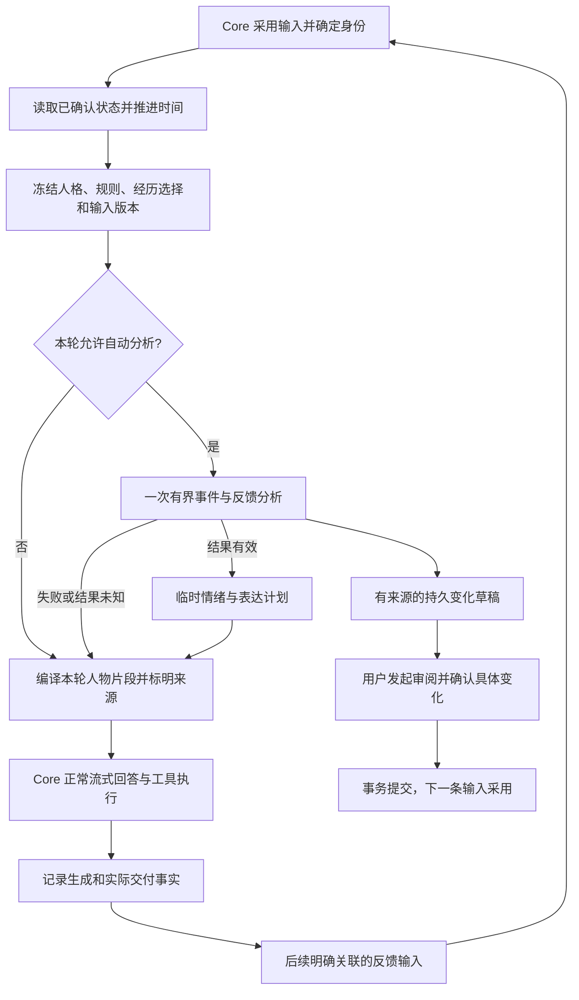

# AffectWeave 后续实施方案：动态情绪、实际反馈与可审查的人格演进

> 实施状态（2026-11-08）：本计划的分析、完整冻结、L2 反馈草稿/确认、回复表达/固定跟进、主动生成宿主、参数/交互及审查演进均已落实到 Go 代码；自动功能默认关闭。历史方案正文保留设计约束，具体已实现/NOT_RUN/延期以 [本版验收记录](VALIDATION_1_6_2026-11-08.md) 为准。两个合成人物真实 DeepSeek 的分析、普通回答与仅生成主动预览已通过；这不替代真人主动 TG 发送及客户端观察。L3 独立业务结果接入/从 L2 补差额仍未交付，明确拒绝模型或保存确认自升 L3。Hytron 生产仍不安装本扩展。


> 2026-11-08 更新：当前实施候选 AffectWeave 为 `1.6.0-dev.1`，配套 FreeAgent `v8.7.0-dev.1`。1.2–1.6 的代码与本地/受控平台闭环已实施，详见验收记录；真实主动 TG 发送与 L3 独立业务证据仍分别列为未运行和延期，不以固定提醒替代动态主动对话验收。

初稿：2026-11-07；基线修订：2026-11-08。状态：实施设计与验收约束；具体完成情况以本版验收记录为准。

本轮启动基线：AffectWeave `1.1.0-dev.1`，发行快照 `2210a4e340b9bd792738f84f20f1d2c694d901ab`；FreeAgent `v8.6.0-dev.1`，发行快照 `53f77022a97670e09d37067b8de54418857ae961`。两仓库已有未提交修改继续保留。后续版本号属于 AffectWeave，FreeAgent 的必要通用宿主改动单独记录版本与最低能力要求。

用户已在 2026-11-08 为查看普通 Core 界面而卸载 Hytron AffectWeave；人物数据库与配套备份保留。编写或实施本方案不代表授权重新安装、恢复人物配置或开启自动分析，线上保持用户当前选择。

目标：让人物能够依据明确事件产生有原因的情绪，依据人格参数调整表达，从实际交付和反馈中形成可确认的变化；在用户允许的范围内，主动判断何时开口、生成有依据的话题，并接续用户回复。用户能知道本轮用了什么、什么已经保存、什么仍只是推测。

跨项目分工：本文件只维护 AffectWeave 的人物业务、对宿主的需求和扩展侧接入。TG 平台能力、Provider 参数与 Core 投递详案在 [FreeAgent 仓库](https://github.com/endview/FreeAgent)的 `docs/FREEAGENT_V8_3_1_TO_V8_5_CHANNEL_REASONING_EXPERIENCE_PLAN_2026-11-07.md` 及其四份专项文档；双方分别提交和验收，不把 FreeAgent 新增渠道能力计作人物算法完成。

执行重点：**1.1.x 基础一致性 → 1.2 动态分析与反馈 → 1.2.x 回复表达 → 1.3 完整主动对话 → 1.4 人格参数 → 1.5 情绪交互 → 1.6 经审查的人格演进**。E1 固定跟进作为可独立验收的中间能力，不阻塞 E2 主动对话。先交付可用的动态人物和交流，再扩展计算能力。

主动对话的产品流程、宿主最小增量、身份/预算/恢复和验收以[主动对话专项](AFFECTWEAVE_PROACTIVE_CONVERSATION_PLAN_2026-11-08.md)为准。本文维护整体版本依赖；专项维护主动模式的具体规则，不各自保存另一套默认值或状态机。

## 1. 当前实现与本次补齐范围

本方案以生产 Go 源码为准。Python v0.2 的功能表、PAB 设计和技能契约用于理解规则，不能替代当前产品验收。

| 能力 | 当前基线 | 后续交付 |
| --- | --- | --- |
| 人物、情绪、关系、经历、未决事项持久化 | 独立 PG、事务、CAS、原操作核对已有 | 复用现有存储，补冻结与反馈约束 |
| 多情绪、同类型按原因/对象共存 | 已实现 | 保留原因身份，不合并成单一心情标签 |
| 衰减与未决残留 | 固定时间常数 3600 秒、残留系数 0.30 | 接入明确的人格恢复参数；保留无新事件时的自然衰减 |
| 人物上下文 | 已编译并接入真实模型 | 同一输入冻结完整片段，增加本轮临时评价和表达计划 |
| Text/JSON/Messages | 已改为扩展提供结构化片段、Core 负责消息 | 沿用当前分工，无旧包装恢复任务 |
| L0/L1/L2/L3、结果回流 | 生成/交付事实和确认后的回流接口已有 | 补真实来源关联、自动候选生成、可用的审阅入口 |
| 自动输入分析 | 只有未接入调用链的 `analysis_enabled` 字段 | 显式开启后，有界调用宿主模型；关闭时零额外请求 |
| 可变 Persona | 手动编辑、版本递增、下一条输入采用已有 | 增加基于证据的参数调整提案、确认、冻结与回退 |
| Persona 数值驱动 | `Values/Traits` 主要用于存储、校验和上下文 | 类型化参数进入情绪和表达的确定性计算 |
| 情绪促进、抑制、转化 | 未实现 | 小规模、有界、顺序无关、保留来源的规则 |
| 主动对话 | Core 有固定一次性投递，AffectWeave 无到期生成/主动决策 | 1.3 补合法触发、当时上下文、说/不说判断、一次生成、真实投递和同会话接续 |

当前真实人物测试证明的是人物选择、上下文注入、正常回答与接续。不能据此宣称自动情绪分析、自动反馈或人格演进已验收。

源码入口：[规则](../internal/affect/rules.go)、[上下文编译](../internal/affect/context.go)、[数据类型](../internal/affect/types.go)、[存储](../internal/storage/postgres.go)、[协议](../internal/extension/server.go)。

## 2. 产品边界与方案选择

### 2.1 必须保持的边界

- AffectWeave 是可选的独立 Go 扩展。人物规则、评价、情绪、关系和经历留在本仓库；FreeAgent 负责通用调用、预算、权限、确认和界面接入。
- 使用现有独立 PG 数据库、受限角色与进程协议。Persona、Affect、Behavior 是代码中的职责与数据维度，不拆成三个进程、三个库或三个调度服务。
- 模型提出的持久人物、心境、情绪、关系、未决事项和经历修改，继续绑定具体内容、来源、范围和版本确认。Full 权限不代替控制面确认。
- 原始输入、模型调用记录、交付回执、冻结快照以及计算结果的审计记录可以正常落库。保存“模型曾提出这个判断”不代表采用该判断作为人物事实。
- 人格和情绪只影响表达风格及允许范围内的回应倾向，不修改事实、事实置信度、权限、工具授权、模型路由或任务预算，不因人物情绪扣留任务结果。
- 使用合成角色测试。人物参数由明确配置或经审查的提案产生，不根据 MBTI、家庭条件、诊断或未核实资料自动赋值；本系统描述 AI 角色状态，不诊断真实用户。
- 不增加自动 RAG、全局知识治理、隐式人格学习、插件市场、通用规则编辑平台或第二套 Provider 管理。人物经历与未来“经验总结”扩展的 Skill/Memory 资产分别管理。

### 2.2 采用的实现取舍

| 问题 | 采用方案 | 取舍依据 |
| --- | --- | --- |
| 自动分析放在哪里 | AffectWeave 组织结构化评价，调用 Core 现有 `model.generate` | 复用 Provider、凭据、用量、取消和调用证据 |
| 如何避免每句话弹审批 | 临时评价用于本轮；持久变化先成为草稿，用户选择审阅时生成正式预览 | 保持正常对话和具体确认两种体验都可用 |
| 如何维持跨轮连续性 | 已确认状态持续生效；未确认评价不作为后续轮次的状态起点 | 避免用缓存或草稿形成隐式学习 |
| 如何生成回答 | Core 继续生成普通流式回答；人物片段提供表达建议 | 不增加独立回复引擎，不要求可见回答输出 JSON |
| 如何处理实际反馈 | 下一个已采用输入的分析可同时解释明确关联的反馈 | 通常每条输入增加一次分析，无每轮固定的第二次复盘调用 |
| 如何做情绪算法 | 保留事件增量与指数衰减，分阶段加入人格系数、小型交互规则 | 方便对照已有规则、解释来源和复现结果 |
| 如何做人格演进 | 用户主动发起证据评估，模型提出有界参数差异，确认后保存新版本 | 支持变化，同时避免后台扫描与自动漂移 |
| 如何主动开口 | 已确认规则产生有限机会，人物到时一次判断并生成，Core 执行与派发 | 可选择不发；复用 Run/Attempt/outbox，不在人物进程另建计时和发送循环 |

**本方案明确的体验代价：未保存的临时情绪不会逐轮累积。** 后续模型可以参考正常会话历史作新的判断，但不能将旧的未确认推断当成已确认人物记忆。若未来需要自动持久化短期情绪，应作为单独的授权设计讨论，本方案不预先打开该能力。

### 2.3 本仓库具体写在哪里

| 事项 | AffectWeave 所在位置 | FreeAgent 的配套责任 |
| --- | --- | --- |
| 情绪、人格参数、行为倾向和人物表达策略 | `internal/affect`；按需增加同包纯规则文件 | 读取有界人物片段；不复制算法 |
| 人物状态、表达偏好、提案来源和已确认版本 | `internal/storage`，独立受限 PG | 统一预览/确认；原消息/执行/投递保留在 Core |
| 评价提示与结构化候选 | 本仓库现有业务入口，必要时同包拆文件 | 宿主模型调用及其预算、Provider 适配 |
| 宿主能力查询、候选提交和结果转换 | `internal/extension` | FreeAgent `extensions.go`、公共协议/schema 和 Core 投递路径 |
| 人物页和本轮人物选择 | UI 代码仍在 FreeAgent 的 `AffectWeavePage.tsx` 与会话组件 | 由 FreeAgent 前端调用扩展状态接口，不另做插件 UI 运行时 |
| TG Markdown、typing、贴纸下载/发送、reaction API | 不在本仓库实现 | FreeAgent 可选渠道的 `internal/channels`、`internal/channelplugin` |
| DeepSeek/GPT 思考模式、强度和协议字段 | 不在本仓库实现 | FreeAgent 模型配置与 Provider 适配文件 |
| 有序发送、限流/静默、定时唤醒、真实回执 | 本仓库只保留候选与原结果引用 | Core 是唯一派发者；TG 负责实际平台调用 |
| 经验总结 Skill/Memory 资产 | 不在本仓库实现 | 独立可选经验总结 Skill，使用 Core 通用产物管理 |

这里的“表达强度”是人物风格参数，与 Provider 的“思考强度”无关。人物可偏好某些已授权资源，但不保存贴纸包的空间授权、平台 token、可独立执行的发送队列或另一套 Provider 配置。

## 3. 自动处理、临时判断与持久确认

| 数据或操作 | 自动执行条件 | 是否进入后续人物状态 |
| --- | --- | --- |
| 输入、生成与交付事实登记 | 来自可信 Core 身份与原记录 | 作为事实来源，可用于核对；不自行改变关系 |
| 既有已确认情绪的时间衰减 | 按已配置、带版本的固定规则 | 是；不产生新的原因、偏好或人格特质 |
| 本轮事件评价、临时情绪和表达计划 | 显式启用自动分析、在调用预算内 | 只影响本轮已采用输入对应的上下文 |
| 临时结果的冻结和审计 | 记录实际调用结果、版本和来源 | 重试同一输入可复用；下一条输入不能直接继承 |
| 关系、情绪、心境、线程、经历草稿 | 从有来源的评价或反馈形成 | 否；未审阅、拒绝、过期草稿不能混入上下文 |
| 具体状态变化 | 用户审阅并通过 Core 确认 | 是；下一条新输入采用 |
| 人格参数演进 | 主动选取证据、生成提案、独立确认 | 是；新增版本，不改写既有输入快照 |
| 主动机会、生成与发送事实 | 1.3 已明确授权的规则与有效唤醒 | 保存执行事实与用量；不冒充新用户输入，不自动改变人物关系/经历 |

草稿默认只显示在人物详情的“待审阅”中。普通聊天不被草稿暂停，不因没有审批让 Run 停在 `waiting_confirmation`，也不每轮弹模态窗口。正式确认仅在用户发起审阅后，复用现有 `extensions.change_state` 操作。

明确区分“已确认状态”“本轮临时判断”“待审阅变化”三种标签。临时判断即使已保存为运行记录，也必须保留该标签；禁止在后续摘要、检索或人物上下文中静默升级。

## 4. 一轮处理流程

本节针对真实用户输入。主动评估没有新用户输入，使用专项定义的独立触发身份和现有 Run 记录，不调用 Adopt 伪造采用；两者的长期状态确认规则相同。



### 4.1 输入采用与冻结

1. 沿用 Core/空间/角色/参与者作用域和“会话 ID/消息序号”的输入身份。排队但尚未采用的消息不触发分析。
2. 每个新输入先读取已确认状态，按可信采用时间推进衰减，冻结基础状态、人格版本、规则版本、设置和授权范围。
3. 冻结必须覆盖本次选中的经历内容、其版本和最终人物片段。当前 `Adopt` 只冻结 state，而编译时仍读取最新经历；本阶段补上完整片段一致性，不能只测 state 的 revision 不变。
4. 同一输入的工具后重入、Provider 替代、刷新、进程重开复用同一有效结果，不重复分析、衰减、耦合或消费反馈。
5. 冻结不冻结权限：停用、授权撤销、角色删除和取消仍由最新权限检查决定是否允许使用。禁止为了复用旧片段绕过撤销。
6. 同空间同角色同参与者的并行会话只在短 PG 事务中串行更新当前状态；模型调用期间不持有行锁。已采用的快照不被另一会话的后续确认追溯修改。

### 4.2 一次分析的输入和输出

分析输入仅包含当前已采用文本、必要的已确认人物数据、选中的经历，以及 Core 已授权的明确反馈来源。首版复用现有事实补读，最多选择两条与反馈直接相关的原回答片段；不新增全历史读取权限。

分析输出分为以下字段，整体按严格 schema 校验：

- `appraisal`：事件性质、明确来源、原因/对象、判断置信度和简短理由。意图是待证实假设，不转写成用户事实。
- `emotion_candidates`：基于事件的情绪刺激；模型不能选择作用域、PG revision、人物版本或直接写最终状态。
- `behavior_hint`：当前任务下的回应倾向和表达建议；最终由确定性规则限制、由 Core 正常回答链路采用。
- `persistent_candidates`：可审阅的状态变化、经历或反馈建议。没有足够来源时返回空集合。

禁止输出自由格式的“心理分析长文”作为状态来源。模型不能自报已经送达、已读或成功，也不能自行把证据等级提升到 L3。校验失败时记录原因并降级，不追加一次“修 JSON”的隐式模型调用。

### 4.3 重试、取消与降级

- 一次输入最多派发一次自动分析。先保存分析已开始的记录，再请求宿主；进程在结果保存前退出时保留不确定性，不自动重发。
- 分析成功后，保存完整冻结结果，再允许它进入本轮上下文。保存失败不能使用未落定的结果后声称可恢复。
- 分析失败、超时、配额不足或 UNKNOWN 时，使用已确认的人物片段继续普通回答，并显示可展开的分析状态。分析 UNKNOWN 不等于主回答 UNKNOWN。
- 降级结果同样冻结；迟到的分析响应不能替换已经用于回答的片段。异常响应保留诊断来源，不重新开启本轮分析。
- 若人物基础身份/边界本身超出预算或权限被撤销，则沿用 Core 对可选扩展的错误处理，明确说明人物片段未采用，不声称角色正常生效。
- 不在普通对话完成后后台补跑本轮分析；下一条新输入提供下一次分析机会。1.3 用户明确开启的主动机会是另一条有原始授权和额度的执行，不用于补跑旧输入。停止必须取消在途分析，旧 invocation 失效。
- 临时分析不调用工具，不发消息，不产生外部副作用。分析超时也不改变普通任务的总步数或总时长规则。

## 5. FreeAgent 配套改动：只补必要的通用宿主能力

以下为待新增设计；当前 `passive_context` 禁止额外模型调用，现有 `analysis_enabled` 字段不能直接当开关使用。

本节记录人物分析对宿主的需求。Host 侧实现、能力校验、Provider 映射和公共协议在 FreeAgent 仓库维护；AffectWeave 只在自己的 `internal/extension` 实现客户端适配与业务校验。发布时公共方法/schema 以 FreeAgent 已实现契约为准，双方有差异先修文档和联测，不分别扩展出两套协议。

### 5.1 显式分析能力

在现有 `freeagent-ext/1` 上增加可协商的 `context_analysis` 能力声明，继续使用 `model.generate`，不增加另一套 Provider 接口。

- `passive_context` 保留无分析的基本模式。声明 `context_analysis` 不自动授权分析，Core 还要验证用户保存的 `analysis_enabled`、本轮选择、有效 invocation 和预算。
- 仅在 `context.prepare` 的 `turn/chat` 调用中，授予有界、无工具的 `model.generate`。不开放 `model.embed`、`tool.call`、`task.delegate`、任意历史、工作区读取或操作拦截。
- None 聊天可以在用户显式开启后使用这种附加文本分析；None 的文件/命令/网络工具权限不因此改变。被动上下文本身不授予模型或工具权限；独立声明并获授权的 delivery 调用继续按现行有限范围检查，不能与分析授权混用。
- manifest 必须声明正数模型调用/输出预算。现有 `0` 表示未额外设限，不能拿 `0` 表示关闭；关闭只由明确布尔开关决定。
- 握手返回实际支持的宿主能力；发行包声明最低宿主契约，缺少必须能力时拒绝启用并给出升级提示。不通过版本字符串猜测，不建设旧宿主兼容分支。
- 模型提出开启分析或调高预算时，走现有设置确认。扩展不能在自己的 RPC 参数里把关闭状态改成开启。

新增能力必须在 manifest 校验、initialize、Host 权限和测试中成套定义。既有 passive_context 的零模型调用语义继续成立；启用分析是用户显式选择的另一种受限调用模式。声明和 settings_schema 的映射不能只有一个未接线的布尔字段，也不能凭扩展名称给 passive_context 绕过权限。

### 5.2 调用、预算与协议

| 项目 | 初始约束 |
| --- | --- |
| 自动分析开关 | 默认关闭；更新现有人物不自动打开 |
| 模型 | 使用本轮当前模型，不单独管理 Key 或秘密 |
| 次数 | 每个已采用输入至多 1 次；每个 Run 至多 2 次，包含运行中采用的引导输入 |
| 输入预算 | 默认至多 4096 tokens，按 Core 的实际估算与上下文能力再收紧 |
| 输出预算 | 每次至多 1024 tokens；同一 Run 至多 2048 tokens |
| 分析期限 | 默认 8 秒；高级设置允许 2—30 秒，服从本轮取消和宿主期限 |
| 片段预算 | 沿用当前 `context_bytes`，并计入 Core 总上下文预算 |
| 耗尽行为 | 跳过剩余自动分析并说明原因；普通回答继续 |

这些是首版工程默认值，须通过真实模型测延迟和有效输出率；调整值需记录依据，不能以绕过测试为目的无限放大。

需要完成的具体修正：

1. AffectWeave 当前 stdio 循环主要处理宿主请求。增加小型双向请求分发：区分请求/响应/取消、关联请求 ID、统一写锁、并发与消息大小上限；等待 Host 响应时读循环继续工作，避免死锁。不因此开发通用 Go SDK。
2. 对齐 manifest 期限、扩展当前固定 20 秒回调期限与分析期限，预留返回和清理时间。不能只改一个超时字段。
3. `model.generate` 调用进入现有 Attempt/usage，绑定扩展、Run、输入和分析目的；恢复、历史显示和上下文压缩不得把分析 JSON 当主回答。次数按真实派发的 Provider Attempt 计数，自动分析关闭隐藏重试/替代，不能用“一次 RPC”掩盖多次请求。
4. 派发前预留本次输出额度，`max_tokens` 不得超过剩余额度。结果未知时保留预留额；收到实际 usage 才结算。修正仅在输出后检查额度可能超支的问题。
5. 同一 Run 的预算跨 hook 共享；Owner 重启后从既有调用记录恢复消费情况。复用 Attempt 和输入记录，不另建额度账本或任务平台。
6. 状态查询、候选读取与实际写回继续沿用 `state.read/preview/apply/result`。外部会话的候选身份绑定原 Run 和已采用输入，不能依赖“此时最新的 running Run”，使回答结束后仍可安全审阅。

### 5.3 主动对话的后续宿主增量

1.3 所需的到期生成不属于本轮 context_analysis，也不修改 delivery.check 的有限复核权限。新增可声明的通用 scheduled_generation、有限机会记录、无新用户输入的触发身份，以及经过 Owner 的一次受限执行；具体设计见[主动专项第 6 节](AFFECTWEAVE_PROACTIVE_CONVERSATION_PLAN_2026-11-08.md#6-唤醒身份与一次执行)。这些名字是拟议契约，不是当前可调用 API。

Core 负责身份、预算、取消、执行和投递；AffectWeave 提供人物快照与说/不说结果。没有启用规则时不新增轮询/模型调用，慢模型不能阻塞渠道 outbox 的发送/回执。规则先确认，规则内的执行事实正常保存；长期状态修改仍单独确认。先用非人物合成扩展证明公共接口不需要人物字段，再接真实人物策略。

## 6. 状态与存储方案

### 6.1 优先复用现有表

| 现有位置 | 增量职责 |
| --- | --- |
| `aw.roles` | 当前人物定义、类型化参数、当前基线和已批准的适应层 |
| `aw.states` | 已确认状态；固定规则推进后的当前投影 |
| `aw.inputs` | 基础冻结快照；增加有界的分析状态/结果和完整编译片段，记录规则/配置/模型调用来源 |
| `aw.facts` | 实际生成/投递事实、原回答关联、已采用反馈的消费记录；1.3 主动评估的来源/冻结结果引用，不伪装 aw.inputs 用户输入 |
| `aw.memories` | 经确认的经历，保留来源和证据含义 |
| `aw.operations` | 确认写回的请求、具体变更、版本、原结果；承载人物版本历史与回退依据 |

首版不新增 Task、Step、Behavior、AnalysisJob、Evidence 等独立持久对象。分析记录放在原输入上；一条输入的候选合并为一个有界草稿。历史查询如需索引，只对实际查询补最小索引。

分析记录应能表达未请求、进行中、成功、跳过、失败、UNKNOWN，并保存原因及原调用引用。这是原输入的一组字段，不是通用作业生命周期服务。候选部分只保存本次选择需要的内容，初始上限 32 KiB；最终片段沿用其单独预算。

### 6.2 防重复与过期提案

- 原 `ControlOperation.ID` 去重继续保留；另按“作用域＋来源分析/反馈＋变化类别”验证语义来源只消费一次，阻止换一个控制操作 ID 重复增加信任或重复写经历。
- 消费记录可用 `aw.facts` 的唯一键实现；它与状态、经历、原控制结果在同一 PG 事务提交，不建跨库分布式事务。
- 同一原行为的 L2 后来补证到 L3，只能在明确预览后应用尚未采用的差额，不能把同一结果完整计入两次。重复转述同一结果不算新来源；纠正旧反馈须关联原消费记录并展示修正影响。
- `aw.states.revision` 会随新输入推进。草稿出现后又聊了几轮，旧预览必须失效；用户再次审阅时显式展示按当前状态重算的 before/after，再确认。
- 重算只复用原合法事件和固定规则，不追加模型请求、不修改旧草稿、不静默套用旧 delta。人格基线、来源或适用条件改变时，提示重新生成提案。
- 延迟批准的情绪按原事件时间计算剩余作用，不能批准时重新开始衰减，导致过期愤怒突然“复活”。已无有效增量时允许仅保存有效经历，须在预览中明确。
- 一个确认内的关系、情绪和经历修改原子提交；用户选择多个独立候选时，各项记录成功/冲突/未执行，不宣称整个批次都成功。
- 拒绝的候选不反复自动提出；同源重试不会生成新草稿。删除状态或经历后的冻结记录、审计保留和上下文可见性要分别说明，不能宣称删除一行等于擦除全部历史。

### 6.3 容量与回收

保留当前有界设计：当前情绪/线程各至多 128、当前状态 256 KiB、来源引用有界。补上自然退休规则：零强度/非活跃情绪、已结束线程在来源可追溯后退出当前工作集；历史由已有输入/事实记录承接。不得静默丢弃活跃事项。

回收在采用输入或显式维护时执行，不增加常驻治理任务。无法腾出空间时拒绝新增候选并提示，普通对话回退到已有状态，不因第 129 个历史情绪永久卡死。

## 7. AffectWeave 1.2：自动分析与最小反馈闭环

交付重点是能用、可解释、能恢复的完整路径；先使用已有固定数值规则，后续版本再加入人格系数和交互。

### 7.1 本轮评价与表达

- 模型提出带来源的事件刺激，规则执行有限值检查、限幅和对象校验，产生临时情绪。
- 已确认状态是计算起点。本轮临时关系假设、意图猜测不得伪装为已确认关系或用户偏好。
- `Decision/Speech` 转为实际编译进上下文的表达建议，记录经过 Core 最终预算裁剪后实际发送给 Provider 的片段引用。片段被裁掉时标记未采用，不能仅保存 Decision 字段后声称已影响回答。
- 表达建议被采用，也不证明模型实际照做。结果回流依据真正生成/交付的内容、实际动作与后续证据，不把计划里的“安慰”“修复”直接记作已经实现的行为。
- 简短、温和、直接、询问和保留空间等作为建议；必要任务内容、引用、工具结果和用户指定格式优先，不做机械字数截断。
- 用户可查看“本轮原因 → 临时情绪 → 表达建议 → 实际采用状态”，不展示模型隐藏推理链。

### 7.2 L0/L1/L2/L3 与结果关联

沿用旧版等级含义，并收紧证据约束：

| 等级 | 可以证明什么 | 不能据此推断什么 |
| --- | --- | --- |
| L0 | 回答或计划已生成 | 实际发送、用户看见、满意或任务完成 |
| L1 | 指定内容实际发送/显示；partial 只覆盖已确认部分 | 用户已读、接受、关系改善 |
| L2 | 存在与原行为明确关联的后续反应或结果 | 模型解释必然正确、所有目标完成 |
| L3 | 具体结果有明确确认或可核验的独立证据 | 一次结果证明整个人格特质或全部子目标成功 |

反馈必须同时绑定：作用域、原输入/Run、实际采用的人物与表达片段、实际回答/产物、交付或执行结果，以及后续反馈输入。尽量使用现有消息/Attempt/回执 ID；仅在现有记录不足以区分内容版本时补摘要，普通用户不需要手动核对哈希。

具体要求：

1. 反馈输入必须在原行为之后采用，且不能就是触发原回答的那条输入。不能只验证该 input ID 在数据库里存在。
2. 首版自动反馈只接受 Core 可验证的 reply-to/消息引用或用户明确选择的原回答。没有明确关联的“嗯”“好”可作为普通新输入，不自动给某个旧回答加成功反馈。
3. `evidence_level` 由来源类型和验证结果限制。模型填入 L3、操作者批准保存，均不自动构成对业务结果的独立证明。
4. TG `sent`、GUI/CLI 呈现回执各自表述真实含义。GUI 断线不能伪造呈现，TG 收到发送回执不能伪造已读。
5. partial 反馈只适用于能确定送达的片段/完成的子结果；缺少具体范围时保留部分/未知。UNKNOWN 不生成成功记忆，也不触发原回答或工具重发。
6. 用户可以明确报告失败、失望或不满；按“用户报告的反应”保存来源候选，不必虚构成功，也不把报告自动升级为全部客观事实。
7. 关系、经历和下一轮情绪可以在同一预览中确认；确认后一次事务写回，重新打开/重复确认不重复增加。

### 7.3 1.2 完成条件

合成角色从一条新输入自动得到临时情绪和表达建议，真实 Core 采用该片段生成回答；后续有明确引用的反馈形成草稿，用户确认后下一条输入采用新状态；拒绝、重复、重启、取消、partial、UNKNOWN 和错误关联均得到正确结果。仅展示上下文 JSON 不算完成。

## 8. AffectWeave 1.4：人格数值进入确定性计算

### 8.1 少量有明确含义的参数

新增类型化 `parameters`，不把当前任意 `values/stable_traits` 键名直接当计算公式。旧的描述字段仍是人物资料；未配置计算参数时使用明确的中性默认值。

| 参数 | 作用 | 初始默认 |
| --- | --- | --- |
| `sensitivity` | 每种既有情绪的刺激敏感度，可有一个默认值和少量覆盖 | 0.5 |
| `recovery_speed` | 情绪向残留水平恢复的速度 | 0.5 |
| `expression` | 情绪进入表达的比例 | 0.5 |
| `regulation` | 对强烈表达的调节程度，不抹掉情绪原因 | 0.5 |
| `directness` | 表达直接程度 | 0.5 |
| `disclosure` | 在已有事实和边界内的自我披露倾向 | 0.5 |
| `repair_preference` | 出现冲突时修复与澄清的倾向 | 0.5 |

全部参数为有限的 `[0,1]` 数值。参数说明必须使用具体行为例子，不标为真实心理测量或医学评分。默认值是工程起点，不由人物姓名、身份或用户材料推断。

### 8.2 计算顺序

先保留能解释、能测试的离散事件与时间衰减：

```text
gain(sensitivity) = 0.5 + sensitivity
tau(recovery_speed) = 3600 × 2^(1 - 2 × recovery_speed) 秒
residual = 已确认且仍未解决的对应事项所支持的残留
decayed = residual + (previous - residual) × exp(-elapsed / tau)
impulse = clamp(event_delta × gain, -0.25, 0.25)
current = clamp(decayed + impulse, 0, 1)
expression = bounded_persona_weights × emotion_tendencies
```

- 中性敏感度和恢复速度分别得到增益 1、时间常数 3600 秒；`elapsed=0` 时新事件仍有反应。
- 同一时间点的两个独立新事件分别消费一次；同一事件重复到达不再次施加 impulse。
- 参数影响情绪强度、恢复和表达，不改变事件是否真实或证据等级。
- 除已配置的固定时间衰减外，本次事件刺激以及后续版本的耦合/转化先作用于临时副本；确认前不写入 `aw.states`。不能把确定性算法包装成跳过持久确认的理由。
- 表达倾向使用固定的小型映射，输出少量建议：澄清、支持、探索、修复、明确边界、保留空间。每个系数给出范围、方向和单调性测试，不让模型自写计算代码。
- 当前 Medium 保留 valence/activation/energy/stress 和已有有限增量规则，不并行新增 PAD 字段或新的心境求解器。临时和已确认投影分别计算；energy 仍要求角色自身的有效来源，不由用户病史推导。
- 暂不采用大规模权重矩阵、连续求解器或开放式情绪基线生成。先用可复现的行为差异验证参数确实有用。

### 8.3 1.4 完成条件

相同事件与相同初始状态，只改变某个人格参数，情绪强度、恢复曲线或表达建议产生预期方向的变化；中性参数与基准规则一致。实际发出的模型请求包含对应表达建议，真实回答的差异用合成场景人工核对，不用单次措辞巧合作为算法通过证据。

## 9. AffectWeave 1.5：情绪促进、抑制与转化

### 9.1 有限规则与同步计算

首版使用代码中带版本号的小型规则表。规则是产品的表达模型，不宣称是普适心理规律。用户可开关交互及调整总强度，不开发任意公式或规则图编辑器。

起始合成规则供实现与对照，最终系数随测试固定：

| 来源 → 目标 | 作用 | 适用范围 |
| --- | --- | --- |
| 希望 → 恐惧 | 抑制 | 相同原因和对象，存在尚可行动的明确条件 |
| 感激 → 愤怒 | 抑制 | 相同原因和对象，存在具体修复或帮助事件 |
| 恐惧 → 悲伤 | 促进 | 同一明确损失/威胁事件，不跨不相关事项传播 |

首版每条边权重绝对值不超过 0.10；同一目标合计变化不超过 0.10，再乘用户设置的总强度 `[0,1]`。总强度为 0 时效果为零。默认关闭，显式开启后从下一条输入采用新规则版本。

计算阶段固定：

1. 衰减、施加本次事件刺激，得到快照 E1。
2. 所有促进/抑制项仅从 E1 读取，同时生成 E2。不能在遍历中读取已经被另一条边改过的值。
3. 有合格新事件时，从 E2 的同一快照计算转化，统一限幅后得到 E3。
4. 派生表达建议。重复 hook 不重算上述阶段；没有新外部事件时只进行既定衰减，不反复循环放大交互。

抑制/促进首版只作用于已存在的对应原因情绪，不凭一条泛化边自动生成另一种情绪。不同原因、对象或空间默认不相互作用。

### 9.2 转化必须有新来源

先实现两类可验证的转化：确认担忧事项已解决时“恐惧 → 宽慰”；确认某个期待目标失败时“希望 → 失望”。原事件没有确认、仅生成一段安慰，或结果 UNKNOWN，均不满足条件。

每次从原情绪转出的量至多为原强度的 25%，且不超过 0.10；所有转出之和不能超过可用强度。新情绪保留原原因/对象，并增加本次解决或结果证据；历史来源不被改写。每个新来源只触发一次，不在同轮形成往返转化链。

### 9.3 1.5 完成条件

规则顺序、map 遍历顺序、输入重放均不改变结果；持续同类刺激不越界，无事件时不自激，互相促进的规则不能无限增强。原因隔离、同类多实例、关闭交互、延迟批准和重启都通过。真实样例说明用户能感知到什么差异，并披露模型表达仍有随机性。

## 10. AffectWeave 1.6：经审查的人格演进

### 10.1 数据与触发

- 使用“固定基线＋已批准的累计参数覆盖”计算有效参数：`effective = clamp(baseline + approved_overlay, 0, 1)`，读时不遍历无限补丁链。人物身份、边界和事实不参与自动适应。
- 用户主动点击“评估人格变化”，或通过 CLI/AI 发起同等操作，选择具体、已确认的交互结果范围。首版无每轮评估、定时扫描和后台学习。
- 首版将评估作为用户显式发起的普通 Core 对话请求，选定资料由现有有界状态读取提供，正常模型链路生成控制提案；GUI 按钮进入同一流程。扩展负责参数/证据校验，不新增后台评估任务、工作流能力或额外 Provider。用量归属该真实 Run，不能重置另一个在途 Run 的分析配额。
- 评价某个参数至少需要两个独立的具体来源；同一消息的改写、同一结果的重复转述、模型自己的回复与自评不算独立来源。不足时给出“证据不足”，不凑参数差异。
- 参数提案含旧值、新值、具体来源、理由、适用基线、预计影响及不确定性。单次改变不超过 0.05，累计偏离基线不超过 0.20；初始为工程限制，按明确版本调整。

### 10.2 确认、冻结与回退

- 复用 Core 预览/确认，确认后增加人物版本；下一条输入采用，既有回答和输入快照不重写。
- 默认关闭人格演进提案。冻结后禁止新评估提案和旧提案生效，已有有效人格继续可读。
- 当前 `Persona.Frozen` 表达已冻结的人物定义，不能直接复用为“开启自动学习”的开关；新增设置使用清晰的演进开关和基线版本。
- 回退是确认后创建一个复制历史有效参数的新版本，不删除历史。完整版本和来源优先复用 `aw.operations`；发布前验证能分页还原版本，若不足才增加必需字段/索引。
- 用户直接编辑身份或大幅调整参数仍走正常人物编辑，明确形成新基线；旧基线上的待审阅演进提案失效，覆盖层不能自动挪到新基线上。
- 同一角色被授权给多个空间时，角色定义变化影响这些空间，预览必须列明。空间内模型不能凭本空间对话擅自修改共享角色定义；需具备角色管理权限的用户操作。

### 10.3 1.6 完成条件

“选择证据 → 评估 → 查看影响 → 批准/拒绝 → 新版本生效 → 冻结/回退”实际可用；重复来源不抬高证据，未批准提案不改变参数，不越过边界，不以运行成功替代人格证据。用户能看到版本差异与其影响范围。

## 11. 设置、对话入口与开发文档

### 11.1 沿用现有界面位置

设置 → 能力 → 扩展 → AffectWeave，按人物、运行、状态与待审阅、主动对话、版本与数据组织。沿用 FreeAgent 自带按需加载页面，不加载扩展任意脚本。主动对话页首项是默认关闭的总开关，只有用户打开并确认联系范围后才允许主动评估/发送；其状态与 Core 同一授权记录一致。

| 项目 | 保存与作用范围 | GUI / CLI / AI 行为 |
| --- | --- | --- |
| 扩展启用、自动分析开关和预算 | Core 扩展配置；允许本轮显式关闭分析，不能在本轮提高持久上限 | 同一设置控制操作；变更显示额外调用成本和生效时机 |
| 人物选择 | 现有会话/本轮能力选择 | 复用当前入口和快照，不加入全局默认人物的隐式切换 |
| 人格参数、交互规则开关/强度 | 人物定义或明确运行配置，展示受影响空间 | 同一具体预览与确认；新输入生效 |
| 临时状态与分析原因 | 当前输入冻结结果 | 只读展开，含采用/跳过/失败/UNKNOWN |
| 状态与经历草稿 | 原输入的候选内容 | 选择审阅后生成现有控制预览，可拒绝或确认 |
| 演进评估、冻结和回退 | 明确角色与基线版本 | 主动发起、明确用量、具体确认 |
| 主动对话策略与授权 | 人物策略归扩展；目标/时段/次数/用量归 Core 的同一授权规则 | 安装后显示；允许普通回复、输入分析和主动联系分别选择；暂停、只生成预览与发送含义明确 |

可调项必须有“字段 → 保存位置 → 范围 → GUI → CLI/AI → 生效时机”的覆盖清单。普通页面展示必要参数和自然语言说明，详细数值、原因引用与调用耗时按需展开。

### 11.2 TG 与公网

- TG 普通消息默认保持自然回复，不追加每轮情绪报表或强制审批。
- 人物状态和待审阅数量通过显式查询获得。需要保存时使用 Core 已认证的预览/确认；当前公网扩展管理存在只读限制，不能仅因登录成功就宣称可以修改。TG 不具备对应确认入口时，使用现有本机 GUI/CLI；若本版交付公网确认，必须单独完成会话身份/CSRF/作用域与现有控制面的验收，不新建确认码协议。
- 后续输入归因使用可信平台 reply-to 到 Core 消息的映射；插件只传递身份和引用，判断与权限留在 Core/扩展。
- Owner、普通私聊参与者、群聊成员的读取与确认权限分别验收；一条群消息不自动获取其他人的角色状态、经历或共享角色管理权。

### 11.3 文档交付

同步更新 [README](../README.md)、[架构](ARCHITECTURE.md)、[宿主接入](FREEAGENT.md)、[规则对照](REFERENCE_MAPPING.md) 和发行说明。FreeAgent 更新通用扩展指南、manifest schema、示例和契约测试。

开发指南需覆盖：增加一种评价字段、增加一个人格参数、增加一条交互规则、处理反馈来源、编写不依赖真实人物的固定场景、排查分析降级与 UNKNOWN。必须区分现有可运行命令与计划新增入口，不能把拟议能力写成已存在。

### 11.4 人物表达策略与分段、贴纸、主动表达

以下为 **AffectWeave 1.2.x 的表达接入批次 E1**，依赖 A2 的可用闭环及 FreeAgent 对应的通用表达/投递能力，在 E2/A3—A5 之前或独立交付。FreeAgent v8.6 已有有序交付、资源授权、逐项回执、一次性候选及到期复核；这些属于宿主已实现基础，不在本扩展重做。AffectWeave 尚未实现人物策略驱动的候选生成与 delivery.check，不能把通用接口通过算成人物主动对话完成。

分两步验收：E1a 先让普通回复中的语义分段、emoji/贴纸/反应选择体现人物与当前事件；E1b 再接一次明确事项的主动跟进，默认关闭，单独开启规则、目标与静默/频率约束。无 E1b 授权时 E1a 仍可用。现有自然段算法保留为不增加模型调用的选项，不为选一句表达再固定追加一次模型请求。

E1b 使用当前有效调用中生成并冻结的具体文字或获准贴纸，到期仅复核是否仍适用，不重新生成内容。候选正文、失效时间和原结果由既有 Core 接口承载；不新增常驻人物循环、自己的定时器或第二份 outbox。按当时状态重新判断/生成和可选低频开场在 1.3 的 E2 实现，不把 E1b 的完成当成它们已经可用。

#### 人物侧负责的内容

- 按明确人格、当前任务和临时情绪给出语义分段偏好，例如希望把简短回应和补充说明分开。只提交有界的逻辑建议，不计算 TG 字符限制或实体偏移。
- 根据已授权的资源候选，给出 emoji、贴纸或消息反应的倾向/选择。不维护 Telegram file_id 目录，不决定一个群是否能读私聊贴纸收藏。
- 在允许的事件触发下提出固定跟进候选，说明来源、目的、已生成的具体文字/获准贴纸、有效期和取消条件。持久触发授权由用户在 Core 中确认；到期生成归 E2，不混入固定候选。
- 角色偏好、主动表达动机和事项状态保存在本扩展范围内；拟表达内容不是“已经发送”的事实。实际目标、时间、频率、静默和可用渠道由 Core 裁决。
- 收到用户新消息或人物事项已解决时，撤销不再适合的候选；到期重核通过新的合法回调完成，不继续使用过期 invocation，也不增加自己的常驻定时器。
- 读取 Core 返回的真实消息/贴纸/reaction 结果，再按本文的反馈与确认规则处理。用户点表情是一个有来源的反应，不自动证明满意、爱意或 L3 成功。

人物分析的 `context_analysis` 继续是无副作用的文本分析。候选建议可以作为其结构化结果保存，但提交外部表达须走单独声明、显式授权的宿主能力；不能因为启用了人物分析就解锁主动发送。

#### 对接顺序与能力降级

1. 从 Host 获取本轮允许的表达类型和资源引用，不根据渠道名称猜测可用方法。
2. `internal/affect` 生成有界人物表达建议，`internal/extension` 提交给 Core；Core 绑定身份、原 Run/输入、目标授权并返回原候选/交付引用。
3. Core 以通用规则受理、拒绝、取消或派发；渠道负责平台转换与收发，实际结果由 Core 记录。本扩展保存原结果引用，不能新建第二份可执行 outbox。
4. 同源候选重复提交只核对原结果。被拒绝、资源不可用或宿主不支持时回退为普通文字建议，不伪造“已经发贴纸/点赞/主动联系”。
5. 人物基础功能不依赖 TG；关闭渠道仍能编译人物、计算情绪。关闭 AffectWeave 后，已启用渠道的普通贴纸、reaction、必要平台分片和用户明确的一次性提醒仍可用；人物语义分段、回复形式选择与主动动机随扩展退出，不在普通 Core 保留一份表达策略。

#### E1 验收

使用合成人物分别验证语义分段、从获准资源选择贴纸/反应、一次明确事件的主动表达候选；核对受理/拒绝/取消、partial/UNKNOWN、过期与撤销。不把收到授权、生成候选或 Core 排队等同于送达，不因表达结果自动绕过持久关系/记忆确认。

FreeAgent 侧详细契约的唯一维护文件为 `docs/CORE_REPLY_DELIVERY_PLAN_2026-11-07.md`；TG 平台行为见 `docs/TG_CHANNEL_EXPRESSION_PLAN_2026-11-07.md`；模型请求参数见 `docs/PROVIDER_REASONING_CONTROL_PLAN_2026-11-07.md`。本节只维护人物策略和扩展调用，不复制这些模块的参数/限流/API 规则。

### 11.5 AffectWeave 1.3：完整主动对话

完整专项见[主动对话实施方案](AFFECTWEAVE_PROACTIVE_CONVERSATION_PLAN_2026-11-08.md)。范围包括明确事项跟进和用户选择开启的低频自由开场；到期读取获准的当前人物/近期交流，一次判断说或不说并生成，经过重新授权校验后交付，用户回复后回到同一会话的普通执行。

必须有可复现的“不发送”路径，用户输入优先，上一次未回复不继续追问；静默、日额度、未解决 UNKNOWN、恢复与卸载均有明确规则。此阶段不需要人格演进、自动 RAG、搜索最新新闻或自由工具调用。Core 不认识人物动机，新增宿主能力只承载有限的已授权扩展触发执行。

既有 `delivery.check` 禁止模型调用，既有 `extensionIdentity` 依赖真实 adopted_inputs。这两处是明确的开发前置，不能绕过现有检查或伪造用户输入让 E2 表面可用。没有经确认的主动规则则零新增主动扫描/调用，不能因为安装人物包就开始联系。

## 12. 实施里程碑与验收

### 12.1 顺序与退出条件

| 阶段 | 主要改动 | 退出条件 |
| --- | --- | --- |
| A0：1.1.x 基础修正 | 完整片段与经历冻结、严格反馈关联、来源去重、容量退休、停用/卸载进程清理、旧文档能力标注 | 针对性 Go/PG 回归通过；隔离验证中保留既有人物与来源；同输入重入片段一致，停用后无残留业务调用/进程 |
| A1：1.2 宿主与自动分析 | 最小能力协商、双向 RPC、有界模型调用、取消、临时状态、降级 | Mock 和真实 Core 联测；关闭零额外调用；重入不重复派发；真实模型有效结果可采用 |
| A2：1.2 可用闭环 | 实际表达绑定、结果来源、草稿、审阅/确认、下一轮采用、管理入口 | GUI/CLI/TG 对应范围验收；确认/拒绝/冲突/恢复和实际反馈多轮通过 |
| E1a：1.2.x 回复表达 | 人物与当前事件驱动的分段、emoji/贴纸/反应建议，复用已有资源授权与具体交付 | 无额外固定表达调用；实际文本/资源受理与回执可核对，关闭后普通 Core 可用 |
| E1b：1.2.x 一次性主动跟进 | 明确事项候选、到期复核、取消、静默/频率限制 | 单独授权；无权限不派发；到时不调用模型，旧 invocation/UNKNOWN 不导致重发 |
| E2：1.3 完整主动对话 | 专项 E2a–d：说/不说决策、当前内容生成、通用唤醒与身份、实际交付、同会话接续 | 真实 Core/PG/扩展/渠道闭环；额外调用有界、用户抢占、无回复不追问、权限/重启/UNKNOWN 正确 |
| A3：1.4 人格参数 | 类型化参数、恢复/敏感度/表达计算、参数编辑说明 | 数值单调性和中性基线通过；固定事件的人格差异可解释 |
| A4：1.5 情绪交互 | 小型交互表、同步计算、事件驱动转化 | 顺序无关、稳定性、跨原因隔离、来源去重和真实表达检查通过 |
| A5：1.6 人格演进 | 主动评估、累计覆盖、证据审查、版本/冻结/回退 | 全流程及越权、证据不足、旧提案、新基线场景通过 |

每阶段先收束一条可运行路径。A2 完成即具备有用的最小动态系统，不以 E1b、E2 或 A5 延后作为阻止 1.2 交付的理由。E2 依赖 A0/A1 的冻结、双向调用、预算和 A2 的真实结果接续；E1b 可复用相同交付基础，但无需为 E2 重做一套固定提醒流程。某阶段未通过则修复该阶段，不用后续算法掩盖调用链缺口。

### 12.2 必须实际运行的测试矩阵

| 类别 | 关键用例 |
| --- | --- |
| 规则基线 | 现有 5 类 Python 固定参考继续通过；有意变化明确新增版本，不修改旧预期掩盖偏差 |
| 完整冻结 | 新经历/人物编辑/配置更新后，同一旧输入仍复用原片段；撤销权限立即阻止使用 |
| 分析输出 | 有效 JSON、截断、未知字段、NaN/Inf、伪造对象/来源、空候选、低置信度、超预算 |
| 调用预算 | 关闭为零；重复 hook 为零新增；初始/引导合计不越界；UNKNOWN、重启、无 usage 仍守预算 |
| 取消与恢复 | 发送前、发送中、结果返回后未保存、事务提交前后断进程；只复用原结果，不重复请求或写回 |
| 协议 | Host 回调与响应交错、同时取消、迟到响应、重复 ID、超大帧、断管，读循环无死锁 |
| 反馈 | 触发输入冒充反馈、反馈早于原回答、错误 reply-to、他人消息、部分送达、UNKNOWN、伪造 L3 |
| 确认 | 预览不采用；拒绝不改变；重复批准一次；换操作 ID 同源不重复；新输入导致旧预览 stale |
| 时间与延迟批准 | 时间倒退、同时间独立事件、跨天间隔、旧情绪迟到确认、无新事件自然衰减 |
| 并发 | 同人物多会话、同空间多参与者、同时编辑与采用、不同空间同名人物，无串数据或丢更新 |
| 容量 | 128 边界、长期非活跃状态退休、活跃内容不可静默删除、经历选择稳定、上下文裁剪保留边界 |
| 参数 | 中性值、极值、单调性、未知键拒绝、固定事件只改变指定维度；参数不改变工具和事实 |
| 交互 | 打乱遍历顺序、互相促进、无事件、不同原因、同类多对象、关闭强度、转化循环和量的边界 |
| 演进 | 不足/重复来源、越界修改、未批准、冻结、回退、新基线、共享角色影响范围 |
| 主动对话 | 总开关默认关闭/开启/关闭/重启、到时更新上下文、speak/skip、无新用户输入的身份、低频机会、共同额度、用户抢占、未回复暂停、逐项恢复；完整矩阵见主动专项 |
| 实际产品 | GUI/CLI 接续、TG 引用反馈、公网断线、设置草稿、批次部分成功、关闭扩展后的正常聊天 |
| 安装与数据 | Windows/Debian 12 最终包、独立 PG、备份/恢复、路径含空格/中文、进程退出和重开 |

先跑纯规则与 mock，再跑真实 PG 和宿主联测，最后跑真实 Provider 和渠道场景。真实模型验收采用合成角色，至少覆盖两个人格、五类场景、每类三次；记录总调用、有效分析、降级、耗时和确认结果，不能挑选最好的一次当整体通过。

模型自然语言表现可波动；硬性验收由来源、权限、冻结、限幅、幂等和实际采用证据决定。无法运行的设备/渠道测试标 `NOT_RUN`；派发结果不确定标 `UNKNOWN`；外部条件不足写具体阻塞，三者不能混用。

### 12.3 性能与效率

- 关闭分析时零额外模型请求、零后台扫描。纯规则在上限状态规模下，发布构建本地基准 p95 初始目标小于 5ms；完整被动片段含 PG 读取的 p95 初始目标小于 100ms。
- 分析开启后分别记录 Provider 等待、JSON 校验、规则计算、PG 和编译耗时；超时在配置期限内终止，不把模型网络等待冒充规则耗时。
- Mock 分析成功/失败的取消响应 p95 初始目标小于 1 秒；真实 Provider 取消同时核对实际请求状态与预算，不能声称取消等于零费用。
- 同一输入重入不产生额外请求。长会话的人物片段大小与当前有界状态相关，不随历史全量增长。
- 在同机、同状态规模和同模型下对比基线；基准须写明硬件、运行模式和样本数量。上述数字为待测目标，不能预填 PASS。

## 13. 数据升级、发行与 Hytron 验证

- 当前 PG 数据需要保留。新增字段/索引使用最小、明确的向前升级步骤，先备份并验证恢复；不建立通用迁移平台，不恢复 Python/SQLite/旧 API 兼容。
- 升级支持的结构版本与读取范围写进程序和文档。较老程序不应直接打开不认识的新结构；回退使用相匹配的程序和升级前配套备份。
- 冻结片段、分析来源、候选、反馈消费记录和人物版本纳入现有配套备份核对。备份与停用期间不得留下在途分析继续写入的窗口；取消/排空规则要与有限写回暂停一起测试。
- 每次发布同时记录 AffectWeave 与 FreeAgent 的实际验证版本。Windows/Linux 独立包包含许可证和使用文档，不含真人角色、聊天、连接文件或 Key。
- Hytron 回归先在独立用户/unit/端口/数据目录完成。常驻 TG 与公网 Owner 的数据不用于故障注入；更新前核对活跃任务、待确认写入、当前配置与备份。
- 生产更新本身不自动开启分析、交互或人格演进。测试通过后明确记录启用范围与实际设置，既有私人角色定义保持可核对。
- 主动规则、待处理机会、生成 Run、用量与投递回执纳入配套备份；恢复的待发项默认不自动发送，核实目标及现存平台事实后再处理。Hytron 当前已卸载扩展，后续版本构建不自动恢复安装或人物主动授权。
- 发布报告列出已实现、未实现、NOT_RUN、UNKNOWN、阻塞和剩余风险。只有真实闭环通过才写“动态情绪与反馈已完成”。

## 14. 当前证据与开工清单

2026-11-07 已对当时基线运行 `internal/affect`、`internal/storage`、`internal/extension` 测试，使用隔离真实 PostgreSQL：12 项顶层测试及 5 项固定参考子场景通过，无跳过。2026-11-08 的 FreeAgent v8.6 配套验收又覆盖 Windows/Debian 12 的真实 PG、扩展进程、竞态检测、人物确认和备份恢复，以及最终 Core/扩展/渠道包的有序分段交付。它们证明当前基础，不覆盖本方案新增的自动分析、情绪交互和人格演进。

当前源码核查仍可确认两个主要输入处理缺口：`Adopt` 冻结 state，但 `context.prepare` 之后重新读取当前 memories 再编译，完整人物片段尚未冻结；`analysis_enabled` 只有参数接收字段，manifest 未提供可启用配置，调用链也未执行自动分析。A0/A1 不得跳过这些缺口。1.1 的 state_version 2 与 aw/storage_version 1 适配已完成，后续直接复用，不列成新的前置开发。

另外补入 A0 的宿主可靠性回归：当前 extensionHost.configure 只更新配置，DeleteExtension 路径未显式关闭缓存子进程。停用/卸载应通过已有关闭方法收束进程与 invocation，并保留原数据/回执；不能要求运维每次额外执行 restart 才真正卸载。这里只修必要的生命周期边界，不建设扩展管理平台。

实际开工从 A0 开始：

1. 核对两个仓库的工作树与现有修改，记录新的源码基线。
2. 为完整片段冻结、错误反馈来源、同源重复确认和容量耗尽建立针对性回归，再修正已有路径。
3. 冻结 `context_analysis` 的最小能力、调用身份、预算和降级契约，同步宿主、schema、扩展与测试。
4. 使用合成角色跑通“自动分析 → 本轮采用 → 实际交付 → 反馈草稿 → 确认 → 下一轮采用”。
5. 完成 1.2 验收和说明后，先独立补人物表达及 1.3 主动对话，再依次推进人格参数、情绪交互、经审查的人格演进；所有阶段先完成对应的受控场景和隔离验收。

本次只修订后续方案；未实现上述新功能、未重新安装线上扩展、未启用自动分析，也未把计划中的测试登记为已通过。Hytron 的当前卸载选择继续保留。
